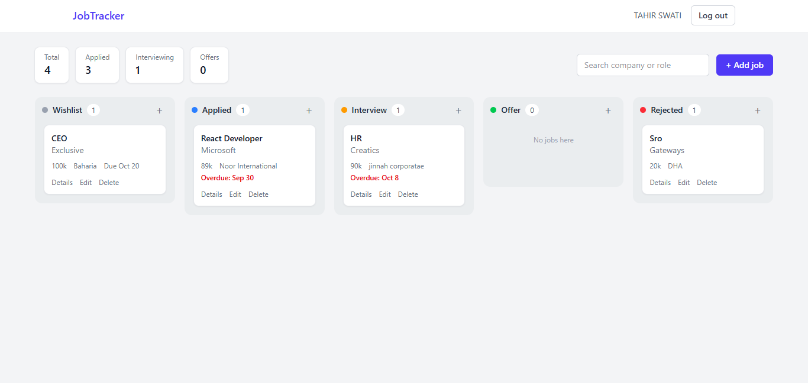
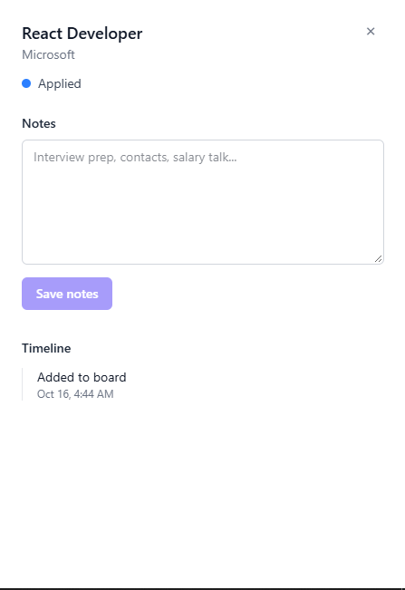

# Job Application Tracker (MERN)

A full-stack job application tracker with a drag-and-drop kanban board. Move each application through **Wishlist → Applied → Interview → Offer → Rejected**, keep notes, and see a timeline of every change.

**Live demo:** https://job-tracker-client-rouge.vercel.app

**Demo account** (so you can look around without signing up):

```
Email:    demo@jobtracker.com
Password: demo12345
```

> The app runs on free hosting. If nobody has used it for a while, the first request can take 5-10 seconds to wake up.

## Screenshots




<!-- Add your screenshots/GIF here, for example: -->
<!--  -->
<!--  -->

## Features

- Sign up and log in with JWT authentication (passwords hashed with bcrypt)
- Each user sees only their own applications
- Kanban board with drag-and-drop between columns (order is saved on the server)
- Optimistic updates: the card moves instantly, and rolls back with an error message if the server fails
- Add, edit and delete applications (company, role, location, salary, job link, deadline)
- Red "Overdue" label for past deadlines
- Search by company or role
- Details panel with notes and an automatic timeline ("Moved to interview", etc.)
- Summary boxes: total, applied, interviewing, offers
- Responsive layout

## Tech stack

| Part | Technology |
|---|---|
| Frontend | React (Vite), Tailwind CSS v4, react-router-dom, axios, @hello-pangea/dnd |
| Backend | Node.js, Express (REST API), JWT, bcryptjs |
| Database | MongoDB Atlas with Mongoose |
| Hosting | Vercel (frontend and backend), MongoDB Atlas |

## API endpoints

All `/api/applications` routes need the header `Authorization: Bearer <token>`.

| Method | Route | Description |
|---|---|---|
| POST | `/api/auth/register` | Create an account |
| POST | `/api/auth/login` | Log in, returns user and JWT |
| GET | `/api/auth/me` | Current user |
| GET | `/api/applications` | List applications (`?status=` and `?search=` supported) |
| POST | `/api/applications` | Create an application |
| GET | `/api/applications/:id` | Get one application |
| PUT | `/api/applications/:id` | Update an application (including notes) |
| PATCH | `/api/applications/:id/status` | Move a card: body `{ status, order }` |
| DELETE | `/api/applications/:id` | Delete an application |
| GET | `/api/applications/stats` | Counts per status |

## Run it locally

You need Node.js and a free [MongoDB Atlas](https://www.mongodb.com/atlas) cluster.

### 1. Backend

```bash
cd server
npm install
```

Create a file named `.env` inside `server/` (see `.env.example`):

```
PORT=5000
MONGO_URI=mongodb+srv://<user>:<password>@<cluster>.mongodb.net/job-tracker?retryWrites=true&w=majority
JWT_SECRET=<a long random string>
JWT_EXPIRES_IN=7d
CLIENT_URL=http://localhost:5173
```

Generate a JWT secret with:

```bash
node -e "console.log(require('crypto').randomBytes(48).toString('hex'))"
```

Start the server:

```bash
npm run dev
```

It runs on http://localhost:5000 (health check: `/api/health`).

### 2. Frontend

In a second terminal:

```bash
cd client
npm install
npm run dev
```

Open the link it prints (usually http://localhost:5173). The frontend talks to `http://localhost:5000/api` by default.

## Deployment

- **Backend:** Vercel project with Root Directory `server`. Environment variables: `MONGO_URI`, `JWT_SECRET`, `JWT_EXPIRES_IN`, `CLIENT_URL` (the frontend URL, no trailing slash). The Express app is exported for serverless use in `server/api/index.js`.
- **Frontend:** Vercel project with Root Directory `client`. Environment variable: `VITE_API_URL` (the backend URL ending in `/api`).
- **Database:** MongoDB Atlas with a limited database user and network access that allows the hosting provider.

## Project structure

```
job-tracker/
├── client/
│   └── src/
│       ├── api/axios.js            axios instance with JWT interceptor
│       ├── context/AuthContext.jsx login state
│       ├── components/             Navbar, Column, ApplicationCard,
│       │                           ApplicationForm, ApplicationDetails
│       └── pages/                  Login, Register, Dashboard (the board)
└── server/
    ├── api/index.js                serverless entry for Vercel
    ├── config/db.js                MongoDB connection (cached)
    ├── models/                     User, Application
    ├── middleware/                 auth (JWT), errorHandler
    ├── controllers/                auth, applications
    ├── routes/                     authRoutes, applicationRoutes
    └── server.js
```

## Security notes

- Every application query filters by both the application id and the logged-in user.
- Clients can only set an allowed list of fields (they cannot set `user`).
- Search input is escaped before it is used in a regular expression.
- CORS only allows the configured frontend URL.
- `.env` is never committed.